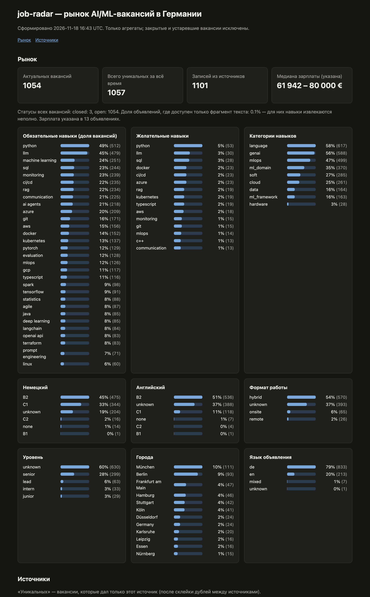
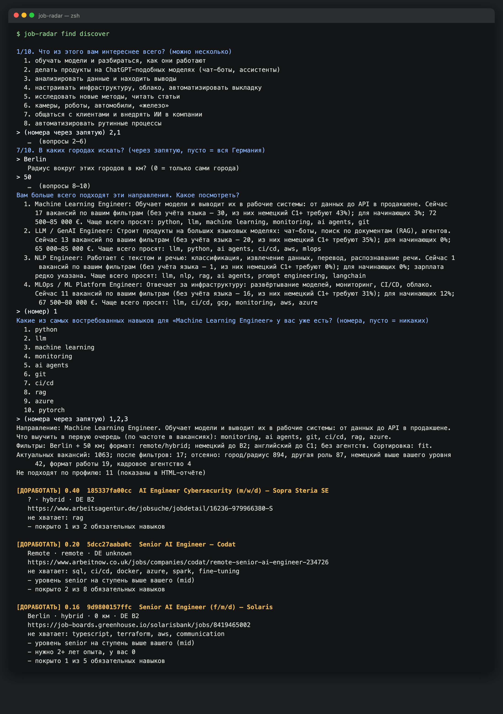
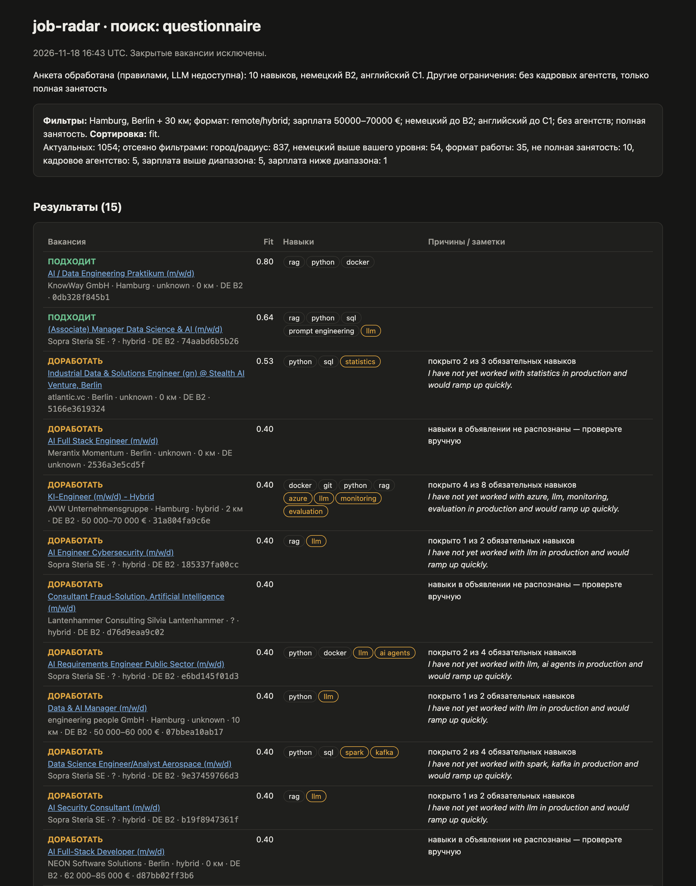
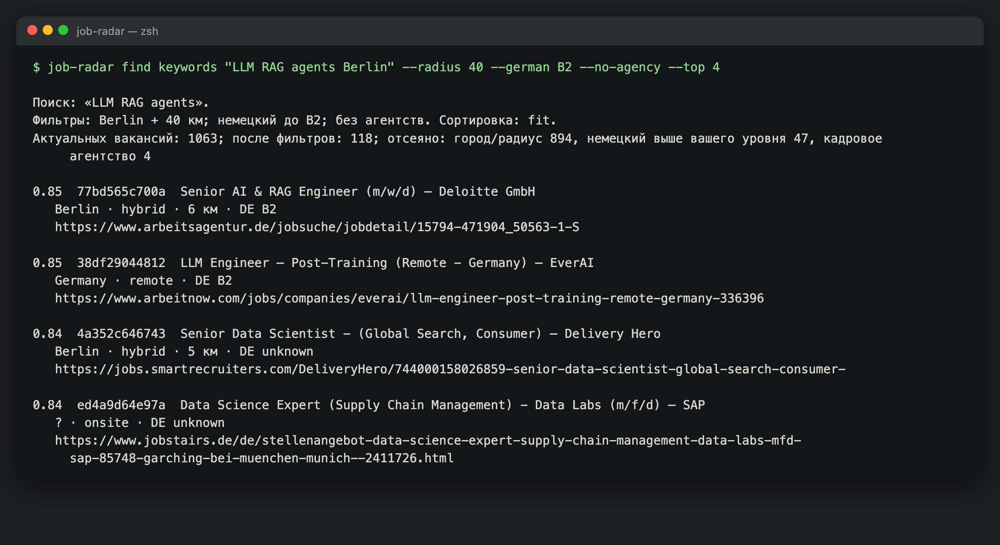
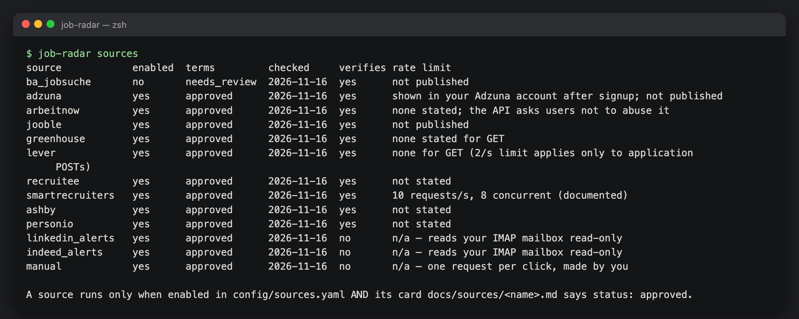
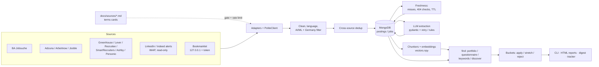

# job-radar

Collects AI and machine-learning job ads in Germany from several sources, merges duplicates, keeps only
vacancies that are still open, extracts structured requirements, and tells a job seeker which jobs they
can apply to now, which need work first, and which do not fit.

Python 3.12 · MongoDB · sentence-transformers · numpy · pydantic · httpx · Docker Compose · MIT licence.



## Problem statement

A job seeker in the German AI/ML market reads hundreds of ads to answer simple questions. Which skills are
actually required? How much German do employers expect? Which jobs fit me, and what am I missing for the
rest? The ads are spread over the Federal Employment Agency, aggregators and company career pages. The same
vacancy appears three times with different titles. A good share of what aggregators show is already closed.

job-radar turns that into one deduplicated, continuously re-checked dataset and answers those questions
from it:

- **What does the market want?** Skill demand, German and English requirements, remote share, cities and
  stated salaries, computed only from open vacancies.
- **What fits me?** Every open job lands in one of three buckets against the candidate's profile:
  - **apply** — the required skills are covered and there is no blocker;
  - **stretch** — close: the missing skills are listed with an honest sentence for the cover letter;
  - **reject** — a hard blocker such as German level, location, seniority, salary or too few required skills.
- **Is it still open?** A job that has disappeared from its source is never suggested.

## Four ways to search

| Mode | For whom | How it works |
|---|---|---|
| `find portfolio ./projects github:<user>` | has projects | Skills are taken from READMEs, `requirements.txt`, `pyproject.toml` and notebooks. The level follows the evidence: a skill in 1 project counts as "used in projects", in 3 or more as "production". |
| `find questionnaire` | prefers to answer in their own words | A Markdown questionnaire generated from questions stored in MongoDB. An LLM turns the free-text answers into a strict profile and search filters. |
| `find keywords "LLM RAG Berlin +python -praktikum"` | knows what to look for | Semantic search. A city in the query becomes a location filter; `+word` must appear, `-word` excludes. |
| `find discover` | does not know yet what fits | Ten sequential questions with numbered answers. The tool then suggests role families, each with live market facts (open jobs, share needing C1 German, top skills, salaries), and finally lists jobs plus what to learn first. |

All modes share the same filters:

| Filter | Flag |
|---|---|
| City and radius in km (exact coordinates from the BA, city centres otherwise) | `--city`, `--radius` |
| Remote, hybrid or on-site | `--workplace` |
| Salary range in EUR per year | `--salary-min`, `--salary-max`, `--only-with-salary` |
| Your German and English level: jobs that need more are hidden | `--german`, `--english` |
| Seniority | `--seniority` |
| Exclude staffing agencies and Zeitarbeit | `--no-agency` |
| Full-time or part-time | `--fulltime`, `--parttime` |
| Permanent contracts only | `--permanent` |
| Suitable for career changers ("Quereinstieg") | `--quereinstieg` |
| No internships or mini-jobs | `--no-internships` |
| Published within N days | `--days` |

Sorting: `--sort fit|date|salary|language|distance`. Sorting by `language` puts the jobs with the lowest
German requirement first. Every run reports how many jobs each filter removed. An unknown fact never
removes a job: an ad that does not mention German passes a German filter.

<table>
<tr><td></td>
<td></td></tr>
<tr><td></td>
<td></td></tr>
</table>

The reports and dialogs are in Russian, the language of the first user. Code, configuration and
documentation are in English.

## Key features

- **13 source adapters behind one interface.** Each adapter implements `fetch()` and optionally `check()`.
  The sources are the Federal Employment Agency, three aggregator APIs, six applicant-tracking systems,
  LinkedIn and Indeed alert emails, and a browser bookmarklet.
- **A terms card for every source.** `docs/sources/<name>.md` records the terms URLs, the date the terms
  were checked, the documented rate limit and a status. The pause between requests and the per-run request
  budget are read from that card. An adapter whose card is not `approved` refuses to run. A card older than
  180 days triggers a "re-check the terms" warning. Machine-specific decisions go into the git-ignored
  `config/sources.local.yaml`, and every override is logged.
- **Polite HTTP client.** A fixed pause per host, a request budget per run, backoff on 429, 5xx and dropped
  connections, and `Retry-After` support. A 403 or a captcha stops the source; there is no bot-protection
  bypass.
- **Cross-source deduplication.** Titles lose gender markers (`m/w/d`, `*in`) and have abbreviations
  normalised (ML, KI). Company names lose legal forms (`GmbH`, `AG & Co. KG`). City names are unified
  (München and Munich). Candidates are compared only within the same company. A match becomes one job with
  a list of sources. A unique index on `(source, source_id)` makes re-runs idempotent.
- **Freshness from evidence.** See [How "still open" is decided](#how-still-open-is-decided).
- **Strict extraction.** Seniority, required and nice-to-have skills, German and English CEFR levels,
  remote policy, salary, city, years of experience and visa sponsorship go into a pydantic schema. The LLM
  runs through an OpenAI-compatible gateway. Invalid JSON is retried with the validation error fed back.
  A rule-based extractor is the fallback and the benchmark baseline.
- **Skill synonym dictionary.** `config/skills.yaml` maps aliases to one name, for example
  `torch` → `pytorch` and `k8s` → `kubernetes`. Short ambiguous aliases such as `go` and `r` are not
  matched in free text.
- **Search from scratch.** There is no LangChain and no vector database. Three hand-written chunkers
  (fixed window, sentence packing, section-aware with a "title @ company" header) feed two multilingual
  embedding models. Vectors live in `.npy`; cosine similarity is a numpy dot product. Liveness is filtered
  from the database at query time, so a job that closes after indexing never comes back.
- **MiniRAG `ask`.** Answers questions only from the retrieved fragments and cites job ids.
- **Application tracker.** `viewed → planned → applied → interview → offer / rejected`. Tracked jobs leave
  the suggestions, and a tracked job that closes is flagged.
- **Reports and digest.** `reports/market.html` holds public aggregates only, with source attribution. The
  personal report with buckets and tracker stays private. A weekly e-mail digest lists new matching jobs.
- **Benchmark harness.** Three chunkers × two embedding models on 40 queries (Recall@5/10, MRR@10,
  nDCG@10), and extraction accuracy per field on 50 hand-checked ads.

## Architecture



## How "still open" is decided

No source has a "this job is closed" field, so the status comes from evidence, strongest first:

1. **A detail check returns 404.** Greenhouse, Lever, SmartRecruiters and the BA support looking up one
   job by id.
2. **The job is missing from a listing that was read to the end.** This counts as a miss; two misses in a
   row close that source reference. A listing cut short by an error, the request budget or a page cap does
   not count, so one failed request cannot close live jobs. Completeness is tracked per company feed and
   per search query.
3. **A job is open** while at least one verifiable source still lists it, and **closed** when all of
   them have dropped it.
4. **Jobs known only from alert emails or manual pages** are marked unverified and shown with a warning.
   They expire after 21 days, or at the page's schema.org `validThrough` date. If the same job also arrives
   from a verifiable source, the merge makes it verifiable.
5. **Anything older than 90 days expires** unless the company's own feed still lists it.

## Data sources

| Source | Access | Freshness signal |
|---|---|---|
| Bundesagentur für Arbeit (`ba_jobsuche`) | `/pc/v6/jobs` list plus `/pc/v4/jobdetails`, the endpoints documented by [bundesAPI](https://github.com/bundesAPI/jobsuche-api). **Disabled by default:** the BA's Nutzungsbedingungen §2a(3) restrict automated collection. The [terms card](docs/sources/ba_jobsuche.md) explains how to enable it locally. | listing misses + 404 |
| Adzuna, Jooble | official APIs, keys required | listing misses |
| Arbeitnow | public API, no key | listing misses |
| Greenhouse, Lever, Recruitee, SmartRecruiters, Ashby, Personio | public job-board feeds of the companies in `config/companies.yaml` | feed misses + 404 |
| LinkedIn and Indeed alerts | the user's own mailbox, read-only; links are never opened | none, TTL |
| Bookmarklet | the page the user is viewing, sent to a local receiver | `validThrough` or TTL |

Only AI/ML jobs in Germany are kept. A generic word such as "KI" or "AI" in a title counts only together
with a technical role or ML technology in the text. This keeps "KI-Engineer" and drops "Rechtsanwalt KI-
und Datenrecht". The rules live in `config/sources.yaml`, and `job-radar prune` re-applies them to stored
jobs.

## Dataset snapshot

<!-- SNAPSHOT:START -->
Collected on 2026-11-18. These are aggregates only; closed and expired jobs are excluded.

- **1054 open AI/ML jobs in Germany** (1057 unique jobs seen, from 1101 source records after cross-source merging).
- **German:** 34% of ads ask for C1 or higher, 45% for B2, and 1% say German is optional.
- **Most required skills:** python 49%, llm 45%, machine learning 24%, sql 23%, monitoring 23%, ci/cd 22%, rag 22%, communication 21%, ai agents 21%, azure 20%.
- **Workplace:** 54% hybrid, 2% fully remote, 6% on-site, and the rest not stated.
- **Cities with the most jobs:** München 111, Berlin 93, Frankfurt am Main 47, Hamburg 46, Stuttgart 42, Köln 41.

| Source | Jobs | Only from this source | Open |
|---|---:|---:|---:|
| ba_jobsuche | 869 | 867 | 867 |
| arbeitnow | 120 | 114 | 120 |
| greenhouse | 45 | 40 | 45 |
| smartrecruiters | 21 | 20 | 20 |
| ashby | 6 | 6 | 6 |
| personio | 3 | 3 | 3 |

_Extraction method for this snapshot: rule-based. With an LLM gateway configured, seniority and language
levels are extracted more completely._
<!-- SNAPSHOT:END -->

## Privacy

Only code, configuration, terms cards and aggregate statistics are versioned. Everything personal or
unpublished stays in MongoDB and the git-ignored `data/` folder: raw ads, CVs and profiles, questionnaires,
vectors, benchmark labels, personal reports and digests. Jobs known only from personal alert e-mails never
enter the public statistics.

## Quick start

```bash
git clone https://github.com/bohdass-source/job-radar && cd job-radar
cp .env.example .env                 # LLM gateway, API keys, IMAP/SMTP: all optional
docker compose up -d mongo
python3.12 -m venv .venv && .venv/bin/pip install -e ".[embed,cv,dev]"

.venv/bin/job-radar sources          # what is enabled and under which terms
.venv/bin/job-radar collect          # collect from approved, enabled sources
.venv/bin/job-radar extract          # structured extraction (LLM, rules fallback)
.venv/bin/job-radar index            # chunk + embed into data/private/index/
.venv/bin/job-radar find discover    # or: portfolio / questionnaire / keywords
.venv/bin/job-radar report           # reports/market.html + data/private/report.html
```

To try every command without touching any source, seed a separate demo database with synthetic ads:

```bash
MONGO_DB=job_radar_demo python scripts/seed_demo.py
```

To run collection, re-checks, extraction and indexing every day, and the digest every Monday:

```bash
docker compose --profile scheduler up -d
```

### All commands

| Command | Purpose |
|---|---|
| `sources [-v]` | sources, terms status, check date and rate limit |
| `companies add <careers-url>` | detect the ATS and board from a URL (no request is made) |
| `collect [--source X] [--dry-run]` | collect, ingest and count listing misses |
| `refresh` | re-check open jobs by id and apply the TTL rules |
| `prune [--dry-run]` | re-apply the relevance and Germany rules |
| `extract [--method auto\|llm\|rules] [--force]` | structured extraction |
| `index`, `search "<query>"` | build the vector index and search it |
| `find <mode>` | the four search modes with filters |
| `profile import cv.pdf`, `profile interview` | build a profile from a CV or a guided interview |
| `match [--bucket apply\|stretch\|reject]` | the three buckets against the saved profile |
| `track <job_id> <status>`, `track list`, `show <job_id>` | application tracker |
| `ask "<question>"` | MiniRAG over open jobs |
| `report`, `digest [--dry-run]` | HTML reports and the e-mail digest |
| `inbox`, `inbox --bookmarklet` | bookmarklet receiver and the bookmarklet code |
| `bench label-retrieval\|retrieval\|label-extraction\|extraction` | benchmarks |

## Evaluation

**Retrieval.** Three chunkers (`fixed` 120 words with 30 overlap, `sentence` up to 100 words, `section` by
ad headings) are compared across two models (`paraphrase-multilingual-MiniLM-L12-v2`,
`multilingual-e5-small`) on the 40 queries in `bench/queries.yaml`. Relevance labels are pooled TREC-style:
only the union of the top 10 from all six configurations is judged.

<!-- BENCH:RETRIEVAL:START -->
_Results are added after the relevance labels are completed (`job-radar bench label-retrieval`)._
<!-- BENCH:RETRIEVAL:END -->

**Extraction.** Each field is scored against 50 hand-checked ads, sampled per source and pre-filled by
the extractor. City names are normalised, salaries count as correct within 5%, and skills are scored with
precision, recall and F1 after synonym normalisation.

<!-- BENCH:EXTRACTION:START -->
_Results are added after the 50 gold labels are verified (`job-radar bench label-extraction`)._
<!-- BENCH:EXTRACTION:END -->

## Tests

```bash
.venv/bin/python -m pytest -q
```

The suite covers adapters against recorded response shapes, the terms gate, the polite client's backoff,
cross-source merging and idempotent re-runs, the freshness rules (including "a failed listing is not a
miss"), extraction with LLM retries, chunkers and the vector index, the three buckets, the tracker, all
four search modes and filters, the alert-email parser, JSON-LD parsing for manual pages, and HTML
escaping in reports. Tests use mongomock and `httpx.MockTransport`; no network is needed.

## Project structure

```
src/job_radar/
  sources/     adapters, terms gate, registry
  pipeline/    clean, relevance + geo, dedup, freshness, store, collect / refresh / prune
  extract/     schema, LLM client with validation retry, rules extractor
  search/      chunkers, embedders, numpy vector index
  match/       profile, guided interview, matcher (buckets)
  find/        filters, engine, portfolio, questionnaire, keywords, discover
  report/      aggregates, HTML
  bench/       retrieval and extraction benchmarks
  rag.py · tracker.py · digest.py · inbox.py · cli.py
config/        sources, companies, skills, roles, search, profile_questions
docs/sources/  one terms card per source
```

## Limitations

- **Without an LLM** the rule extractor leaves seniority unknown for many ads and assumes B2 when an ad
  mentions a language without a level. Point `LLM_GATEWAY_URL` at an OpenAI-compatible endpoint and run
  `job-radar extract --force`.
- **Adzuna and Jooble** return only a snippet of the description, so fewer skills are found in those ads.
- **The alert-email parser** is heuristic and depends on how LinkedIn and Indeed lay out their e-mails.

## Attribution

Job data comes from the sources enabled in a given installation, including BUNDESAGENTUR FÜR ARBEIT (BA),
Jobbörse, https://www.arbeitsagentur.de/jobsuche/, [Arbeitnow](https://www.arbeitnow.com),
[The Adzuna API](https://www.adzuna.co.uk) and [Jooble](https://jooble.org). The public report credits
the sources automatically.

## License

MIT
